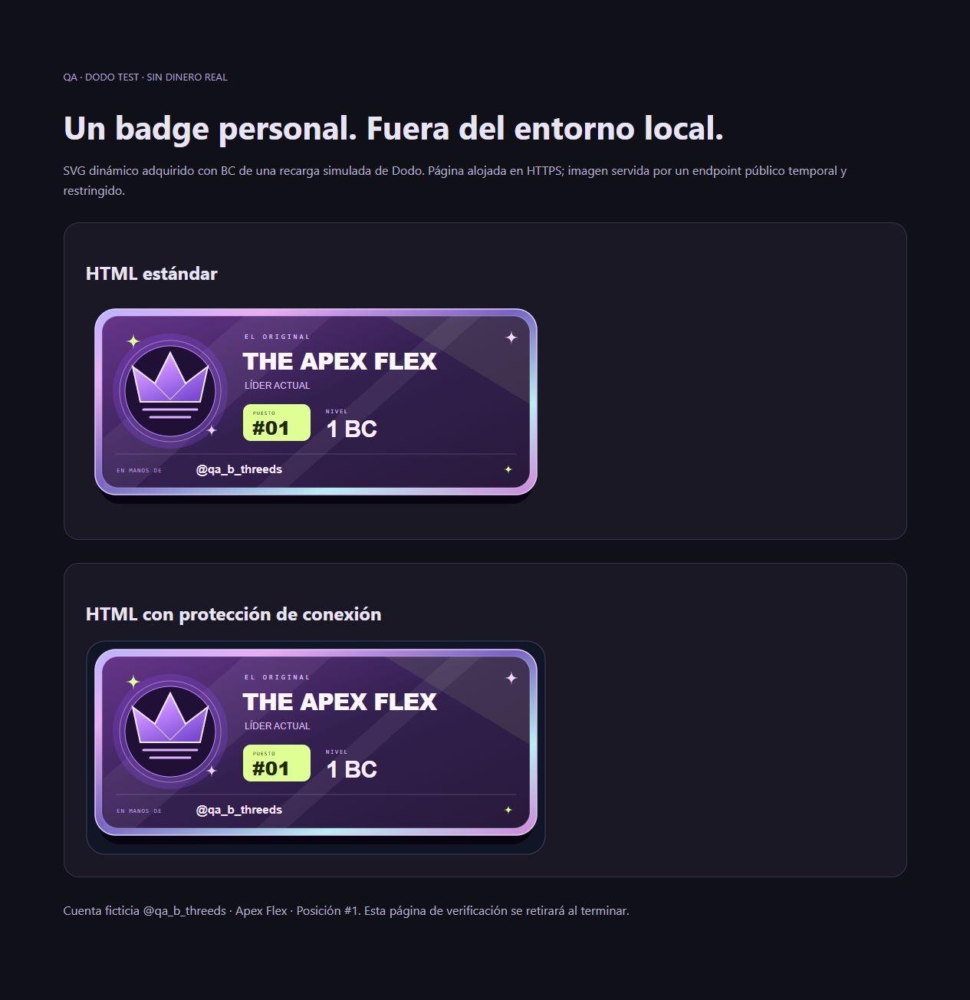
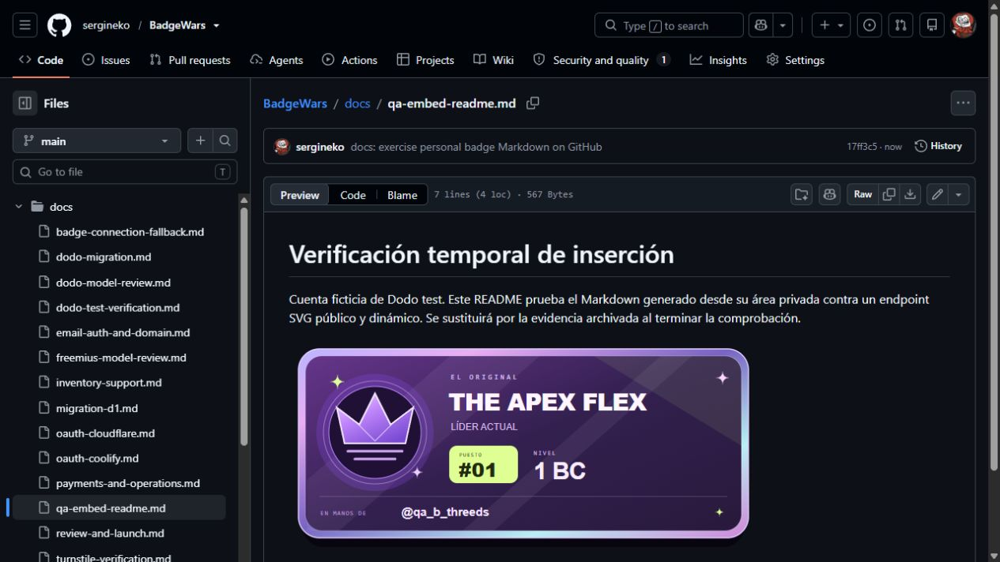

# Inserción externa verificada · 19 de octubre de 2026

El Markdown generado desde el área privada de una cuenta ficticia cargó su SVG personal en GitHub, a través de Camo, con tamaño natural 600 × 280. La imagen era una respuesta dinámica del Worker nativo local, publicada mediante un relay HTTPS restringido; no era un SVG estático subido al repositorio.

También se probaron HTML estándar y HTML con protección de conexión en una página HTTPS de BadgeWars, con la misma imagen personal. El enlace de acción devolvió la página pública correspondiente.

Las capturas son evidencia archivada de **Dodo test**, no badges activos ni saldo real. Tras verificarlo se retiran la página temporal y el túnel: este documento conserva las capturas para no dejar imágenes remotas rotas en main. El commit temporal de prueba fue `17ff3c5`. Los códigos reales se obtienen únicamente desde la colección privada del titular.

[Resultados del bloque B](block-b-verification.md).
